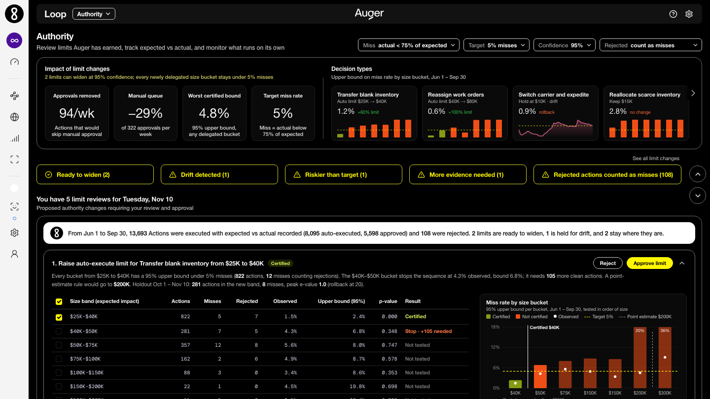

# Certified authority limits for Auger Loop (concept)

**Live demo:** https://mohith26.github.io/auger-authority-limits/

An unofficial concept feature for [Auger](https://auger.com)'s autonomous supply chain OS, built by Mohith Gajjela. Not affiliated with Auger. All data is synthetic.



## What it is

Auger says autonomy is a dial: you advance a decision type from recommendation to autonomous action "as the expected-against-actual record earns it." Today a person still decides when the record is good enough, usually by eyeballing a hit rate.

This adds an **Authority** view to Loop that turns that record into a proposed limit change with a guarantee:

- For each decision type (transfer blank inventory, reassign work orders, reallocate scarce inventory, pull in POs, switch carrier and expedite), it finds the **largest auto-execute limit** such that **every newly delegated size bucket misses less than the target rate** (default: fewer than 5% of actions realize under 75% of their expected impact), **at 95% confidence**.
- It treats **rejected actions as misses** by default. Approvers reject the riskiest proposals, so the approved record looks safer than auto-execution would be. Dropping rejections is offered as a toggle and labeled "not certified".
- After a limit widens, an **anytime-valid monitor** watches the delegated band and recommends **rolling the limit back** as soon as the evidence says the miss rate has drifted above target, with no fixed review date.
- When a bucket is close, it says how many more clean actions would certify it and how many weeks that is at current volume.

## How it works

1. **Buckets.** Above the current limit `L0`, sizes (expected impact in USD) are split into buckets at 1.5x, 2x, 3x, 4x, 6x, 8x and 12x `L0`.
2. **Test each bucket.** For bucket *k* with *n* actions and *x* misses (rejections counted as misses), the p-value for "miss rate > alpha" is the exact binomial tail `P(Bin(n, alpha) <= x)`. The matching Clopper-Pearson upper bound is shown in the table; `p <= delta` exactly when the bound is `<= alpha`.
3. **Fixed-sequence testing (Learn-then-Test).** Buckets are tested in increasing size and certification stops at the first bucket that fails. Because the hypotheses are tested in a fixed order, the chance of certifying any bucket whose true miss rate is above alpha is at most delta, without a multiple-comparison penalty. Testing buckets separately (instead of the whole band) prevents many small, easy actions from hiding a risky high end.
4. **Worst-case rejections.** A rejected action has no outcome. Counting it as a miss can only raise *x*, so the test stays valid whatever the approvers' reasons were (a Manski-style bound).
5. **Rollback monitor.** For the delegated band, each new action gives `Y = 1` (miss) or `0`. The monitor runs a mixture of betting martingales `W_t(b) = prod(1 + b (Y_s - alpha))` for several bets `b < 1/alpha`. Under "miss rate <= alpha" the average is a nonnegative supermartingale, so by Ville's inequality the chance it ever reaches 20 is at most 5%, no matter how long you watch. Crossing 20 triggers the rollback.
6. **Holdout.** The demo certifies on Jun 1 - Sep 30 and runs the monitor on Oct 1 - Nov 10. A certified limit is only proposed if the holdout monitor stays quiet.

Everything on the page is computed in the browser from `data/decisions.json` by `core/authority.js`. Nothing is hard-coded.

## The synthetic data

`scripts/generate.mjs` (seed 20261110) simulates a print-and-embellishment network (Louisville, Charlotte, Dallas, Phoenix, Seattle, Reno), 18,387 actions over Jun 1 - Nov 10 2026. Each action has an expected impact; it is disruption-bound with probability `q = q0 (size/L0)^beta`, in which case the realized/expected ratio is uniform on [0.10, 1.00], otherwise it is Normal(1, sigma). Actions above the current limit go to an approver, who rejects ~35% of disruption-bound actions plus a small base rate. One decision type (switch carrier and expedite) gets a carrier capacity crunch from Oct 15 that multiplies `q` by 7 above its limit. Because the simulator knows `q`, the page can also show each bucket's true miss rate, labeled as simulator truth.

## Results on the demo data (alpha 5%, 95% confidence, miss = actual below 75% of expected)

- Transfer blank inventory: $25K -> **$40K**; Reassign work orders: $40K -> **$80K**. Together about **94 manual approvals a week move to auto-execute (29% of the manual queue)**.
- Reallocate scarce inventory: stays at $15K; its first bucket already misses 5.1% (bound 6.7%). A point-estimate rule would have widened to $30K, a bucket whose true miss rate is 5.8%.
- Pull in purchase orders: stays at $50K; one counted miss (a rejection) in 51 actions is too little evidence. 42 more clean actions would certify the next bucket.
- Switch carrier and expedite: Jun - Sep certifies $15K, but the holdout monitor fires on Oct 20, five days after the simulated onset, so the widening is held.

## Does it keep its promise? (`node scripts/validate.mjs 1000`)

1,000 re-simulations x 5 decision types = 5,000 limit decisions. "Violation" means the rule delegated at least one bucket whose **true** miss rate is above alpha.

| Rule | Violations (alpha 5%) | Widened |
|---|---|---|
| Certified, rejections as misses | 0.0% (1/5000) | 64% |
| Certified, rejections excluded | 3.5% | |
| Point-estimate (observed rate <= alpha, n >= 20) | 30.1% | 100% |

At alpha 3%: 0.0% vs 47.4%. The monitor's false alarm rate at exactly alpha over 400 actions is 2.1% (bound 5%), and it detects a 4x jump in 30 actions on average.

## Tests

```
node --test test/authority.test.mjs
```

10 tests: exact binomial values, Clopper-Pearson / test duality and the rule of three, fixed-sequence stopping (a later passing bucket is not certified), worst-case vs excluded rejections, minimal evidence needed, quadrature truth vs a large simulated sample, re-simulation error control, e-process false-alarm rate and detection delay, data file reproducibility, and consistency of the shipped analysis.

## Honest limitations

- **Worst-case rejections are conservative.** With realistic rejection rates they cost real headroom (about half the counted misses here are rejections). If Auger can replay what a rejected action would have done, a less conservative bound is possible, but it would rest on that replay model.
- **The guarantee assumes the window is representative** (exchangeable actions within a decision type). Seasonality or drift inside the window weakens it; the holdout monitor is the backstop, not a proof.
- **Approvers may edit actions before approving.** Then an approved outcome is not the outcome auto-execution would have had.
- **One miss definition.** Real decisions have asymmetric costs; a loss-weighted version (conformal risk control on dollar shortfall) is a natural next step.
- **The size grid is fixed** (multiples of the current limit). A finer grid gives finer limits but each bucket gets fewer actions.
- **Synthetic data and an approximated UI.** The shell is rebuilt from the one public in-app screenshot of Loop (Microsoft Marketplace listing) and auger.com's design tokens; icons are Lucide stand-ins.

## Novelty

Auger's public material describes the expected-against-actual record as "the accuracy evidence and the basis for widening authority," with the customer setting the limits. Burq published an "Earned Autonomy" ladder (Nov 2026) that promotes segments when retailer-set performance thresholds are met. I could not find a supply chain product that computes the limit itself with a finite-sample guarantee, corrects for approver selection, or uses anytime-valid monitoring for rollback.

## Files

- `index.html`, `style.css`, `app.js`: the Loop shell and the Authority view (CDN: Lucide icons, Google Fonts DM Mono)
- `core/authority.js`: generator, exact binomial tools, certification, monitor, validation
- `scripts/generate.mjs`, `scripts/validate.mjs`
- `test/authority.test.mjs`

Unofficial concept demo by Mohith Gajjela. Not affiliated with Auger. Synthetic data.
